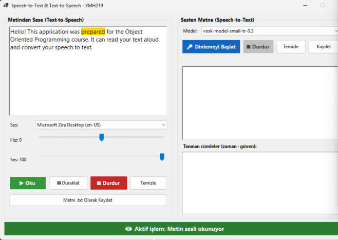
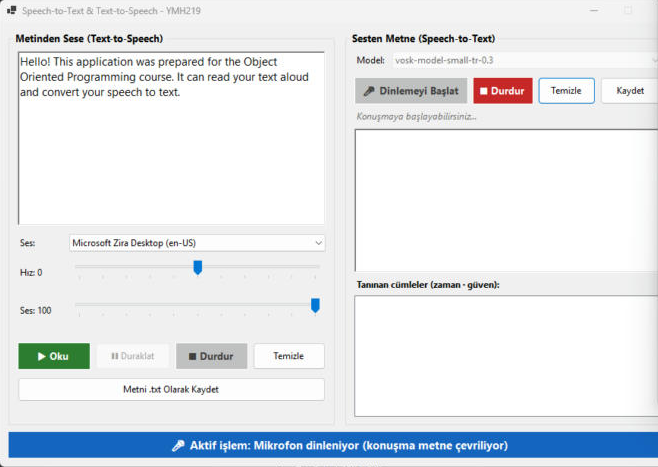
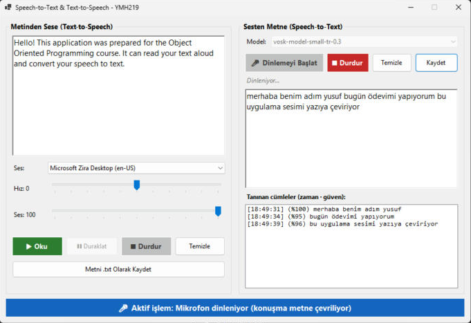

# Speech-to-Text ve Text-to-Speech Uygulaması — YMH219

Ses ile metin arasında çift yönlü dönüşüm yapan bir Windows Forms uygulaması:

- **Metinden sese (TTS):** Yazılan metni Windows'un konuşma sentezleyicisiyle sesli okur; okunan kelime anlık olarak sarıyla işaretlenir.
- **Sesten metne (STT):** Mikrofondan alınan **Türkçe** konuşmayı, çevrimdışı çalışan Vosk konuşma tanıma motoruyla metne çevirir.

Bu proje **Nesne Tabanlı Programlama (YMH 219)** dersi ek uygulama ödevi kapsamında hazırlanmıştır.

**Öğrenci:** Yusuf Aslan — **Numara:** 250541068

## Ekran Görüntüleri

| Metin sesli okunuyor | Mikrofon dinleniyor |
|---|---|
|  |  |

Alttaki renkli şerit hangi işlemin aktif olduğunu gösterir (yeşil: okunuyor, turuncu: duraklatıldı, mavi: mikrofon dinleniyor, gri: boşta).

**Gerçek Türkçe konuşma testi:** Mikrofona söylenen üç Türkçe cümle, internet bağlantısı olmadan, çevrimdışı Vosk modeliyle yazıya çevrildi. Her cümle zaman ve güven değeriyle listelendi (%100, %95, %96).



## Kullanılan Teknolojiler / NuGet Paketleri

| Paket | Kullanım amacı |
|---|---|
| [System.Speech](https://www.nuget.org/packages/System.Speech) | Metinden sese: `SpeechSynthesizer` (Windows'ta yüklü sesler) |
| [Vosk](https://www.nuget.org/packages/Vosk) | Sesten metne: çevrimdışı konuşma tanıma motoru |
| [NAudio](https://www.nuget.org/packages/NAudio) | Mikrofondan 16 kHz mono ses almak (`WaveInEvent`) |

- C# / .NET 10 (`net10.0-windows`, x64), Windows Forms
- Konuşma tanıma modeli: **vosk-model-small-tr-0.3** (Türkçe, ~57 MB, Apache 2.0 lisanslı, [alphacephei.com/vosk/models](https://alphacephei.com/vosk/models)). Model depoda `SpeechApp/Models` klasöründe bulunur, ayrıca indirmeye gerek yoktur.

## Kurulum ve Çalıştırma

1. Depoyu indirin:
   ```bash
   git clone https://github.com/JuseufLeo/YMH219-SpeechApp.git
   ```
2. `YMH219-SpeechApp.slnx` dosyasını **Visual Studio 2026** ile açın. NuGet paketleri ilk derlemede otomatik indirilir (internet gerekir).
3. Yeşil **▶ SpeechApp** düğmesine basın (veya `F5`).

Gereksinimler: Windows 10/11 (64 bit), hoparlör, mikrofon. Windows'ta *Ayarlar → Gizlilik ve güvenlik → Mikrofon* altında masaüstü uygulamalarının mikrofona erişimi açık olmalıdır.

## Kullanım

**Metinden sese:** Sol kutuya metni yazın, ses / hız / ses düzeyini seçin, **▶ Oku**'ya basın. **❚❚ Duraklat / ▶ Devam**, **■ Durdur** ve **Temizle** ile kontrol edin; **Metni .txt Olarak Kaydet** ile metni dosyaya yazın.

**Sesten metne:** Model listesinden `vosk-model-small-tr-0.3`'ü seçip **🎤 Dinlemeyi Başlat**'a basın (model ilk seferde birkaç saniyede yüklenir). Konuştukça "Algılanıyor: ..." satırında anlık sonuç görünür; cümle bitince metin kutusuna eklenir ve altta **zaman damgası ve güven yüzdesiyle** listelenir. **■ Durdur**, **Temizle** ve **Kaydet** (.txt) butonları vardır.

## Hata Yönetimi

- Model klasörü yoksa veya okunamıyorsa: "Konuşma tanıma modeli bulunamadı" mesajı
- Mikrofon yoksa / açılamıyorsa: "Mikrofon bulunamadı" mesajı ve izin ayarı hatırlatması
- Dinleme sırasında mikrofon çıkarılırsa: uygulama kapanmadan uyarı verilir
- Ses çıkışı kullanılamıyorsa veya metin boşsa: kullanıcıya bilgi verilir

## Proje Yapısı (Sınıflar)

| Dosya | Görevi |
|---|---|
| `TextToSpeechService.cs` | `SpeechSynthesizer`'ı sarmalar: oku, duraklat, devam, durdur, ses/hız/ses düzeyi; durum ve kelime olayları |
| `SpeechToTextService.cs` | NAudio ile mikrofonu dinler, sesi Vosk'a verir; tamamlanan cümleleri, anlık tahmini ve hataları olaylarla bildirir |
| `MainForm.cs` | İki servisi kullanan arayüz: butonlar, okunan kelimeyi işaretleme, aktif işlem göstergesi, dosyaya kaydetme |

## Bilinen Sınırlamalar / Geliştirme Notları

- Okuma sesi, Windows'ta yüklü SAPI seslerine bağlıdır. Bu bilgisayarda yalnızca İngilizce *Microsoft Zira* sesi olduğu için örnek metin İngilizcedir; Türkçe bir ses (ör. *Microsoft Tolga*) yüklüyse listeden seçilebilir.
- "Küçük" Türkçe model hızlıdır ama gürültülü ortamda, hızlı konuşmada ve özel isimlerde hata yapabilir. Testlerde mikrofona yakın, yavaş ve kısa cümlelerle konuşulduğunda doğruluk belirgin şekilde artmıştır; daha büyük bir Vosk modeli `Models` klasörüne eklenerek listeden seçilebilir.
- Windows'un yerleşik konuşma tanıması (`System.Speech.Recognition`) Türkçeyi desteklemediği için Vosk tercih edilmiştir.
